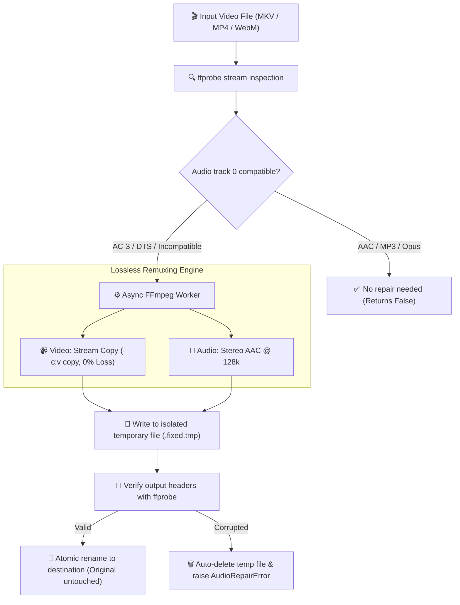

<div align="center">

# 🔊 Orpheus-Audio
### High-Speed, Non-Blocking Async Video Audio Repair for Browsers & Chromecast

[](https://python.org)
[](https://docs.python.org/3/library/asyncio.html)
[](https://ffmpeg.org)
[](https://github.com/Kaio-Comk/Orpheus-Audio)
[](https://opensource.org/licenses/MIT)

**Make videos play instantly in Chrome, Safari, Chromecast, and Telegram by transcoding *only the audio track*.**  
*Video stream is copied bit-for-bit with zero compression loss in seconds instead of hours.*

[The Problem](#-why-orpheus-audio) • [How It Works](#-how-it-works) • [Installation](#-installation) • [Quickstart](#-quickstart) • [Cancellation & Safety](#-cancellation--pipe-safety) • [Contributing](#-contributing)

</div>

---

## ⚡ The Problem: Silent Video Playback

Modern web browsers, TV sticks (Chromecast, Fire TV), and web players (Telegram Web, Discord, Plex, Jellyfin) cannot decode proprietary multichannel audio codecs due to licensing restrictions. The video plays smoothly, but the sound is completely silent.

| Audio Codec | Chrome / Edge | Safari | Chromecast | Telegram Web | Solution with `audiorepair` |
|---|:---:|:---:|:---:|:---:|---|
| **Dolby AC-3 / E-AC-3** | ❌ Silent | ⚠️ Partial | ❌ Silent | ❌ Silent | ⚡ Fast transcode to AAC (stereo 128k) |
| **DTS / DTS-HD** | ❌ Silent | ❌ Silent | ❌ Silent | ❌ Silent | ⚡ Fast transcode to AAC (stereo 128k) |
| **TrueHD / FLAC** | ❌ Silent | ❌ Silent | ❌ Silent | ❌ Silent | ⚡ Fast transcode to AAC (stereo 128k) |
| **AAC / MP3 / Opus** | ✅ Plays | ✅ Plays | ✅ Plays | ✅ Plays | ⏭️ Skipped (Already compliant) |

Re-encoding entire 4K/1080p video files takes hours and degrades picture quality. `audiorepair` copies the video stream (`-c:v copy`) untouched in seconds and only transcodes the incompatible audio stream.

---

## 🏗️ How It Works



---

## 📦 Installation

```bash
pip install git+https://github.com/Kaio-Comk/Orpheus-Audio.git
```

> **Requirement:** Requires `ffmpeg` and `ffprobe` installed on your system `PATH` (or explicitly passed as parameters).

---

## 🚀 Quickstart

```python
import asyncio
from pathlib import Path
from audiorepair import needs_audio_repair, repair_audio

async def main():
    video_path = Path("movie.mkv")
    
    # 1. Non-destructive pre-flight check
    if await needs_audio_repair(video_path):
        print("Audio codec incompatible with web playback. Repairing...")
        
        # 2. Repair with real-time ETA progress tracking
        fixed_path = await repair_audio(
            video_path,
            progress_cb=lambda pct, eta_s: print(f"Progress: {pct:.1f}% | ETA: {eta_s}s")
        )
        print(f"Repaired video ready for streaming: {fixed_path}")
    else:
        print("Video audio is already 100% web-compatible!")

asyncio.run(main())
```

---

## 🛡️ Cancellation & Pipe Safety

### Why Native Async Subprocesses Matter
A blocking `subprocess.run(["ffmpeg", ...])` freezes Python's event loop for the entire duration of the encode. In high-concurrency environments (like Telegram bots, FastAPI servers, or workers), this causes heartbeats to drop and network connections to terminate.

`audiorepair` is built from the ground up for production resilience:
* **Drain Protection:** The stdout/stderr progress pipe is actively drained asynchronously, preventing the OS buffer from filling up and hanging the process.
* **Graceful Task Cancellation:** If the awaiting `asyncio.Task` is cancelled or times out, the FFmpeg process tree is killed immediately (`SIGKILL` / `TerminateProcess`) and temporary files are cleaned up.
* **Targeted Track Inspection:** Inspects specifically `stream:a:0` to guarantee that multi-track files with audio commentary don't fool the player.
* **Integrate with Distributed Queues:** Pairs seamlessly with [**`pg-lease-queue`**](https://github.com/Kaio-Comk/pg-lease-queue) to run repairs as durable background jobs across server restarts.

---

## 🧪 Testing

```bash
pip install -e ".[dev]"
pytest -v
```

---

## 📄 License

Distributed under the **MIT License**. See `LICENSE` for details.

<div align="center">
  <sub>Built with ❤️ by Kaio Lima. If Orpheus-Audio saved you encoding time, please give it a ⭐!</sub>
</div>
